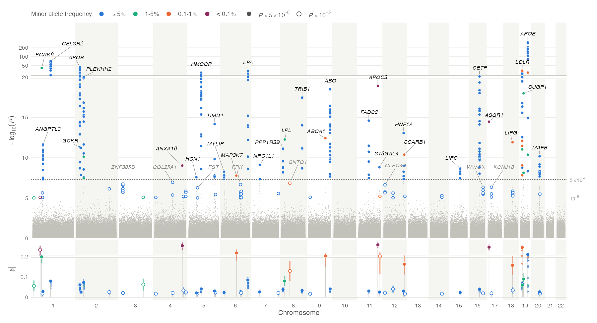
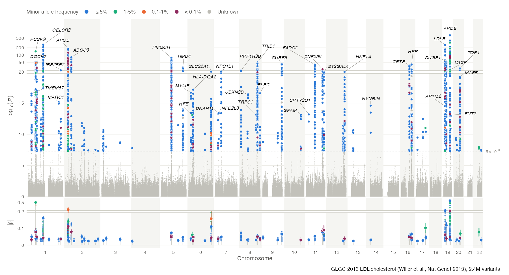
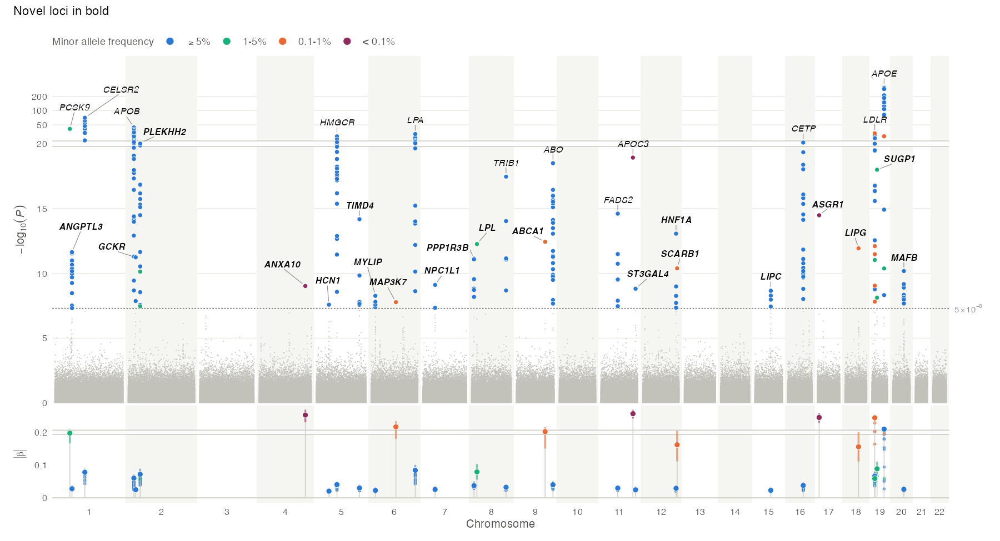
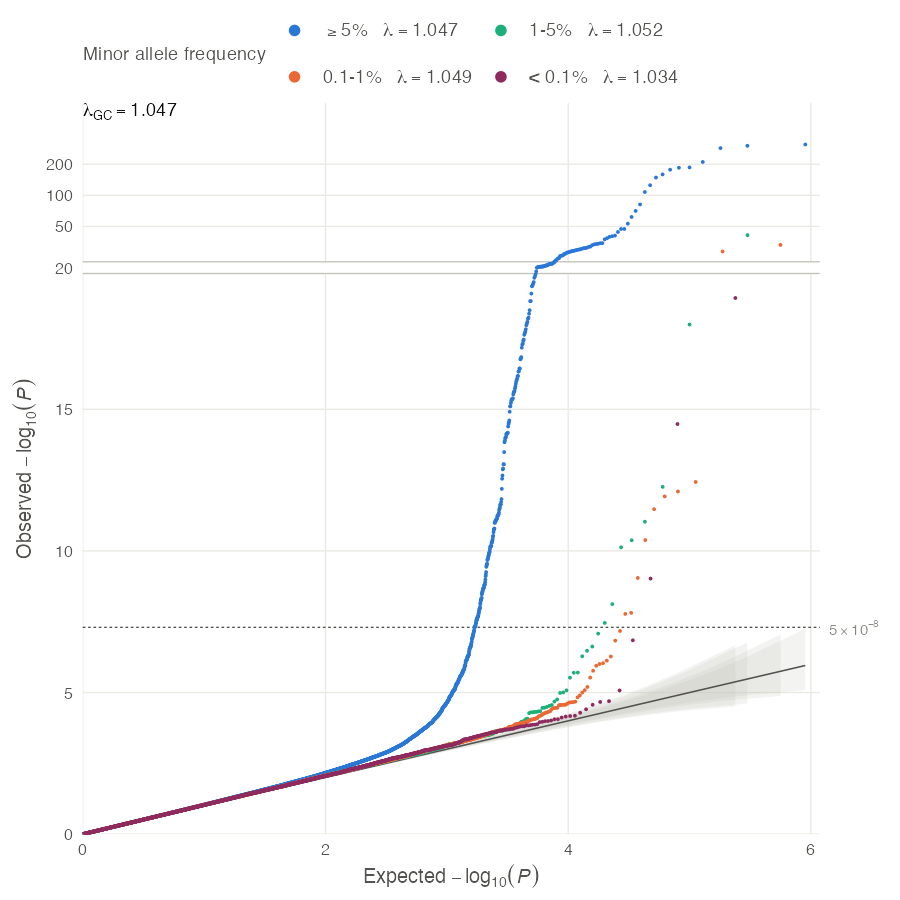
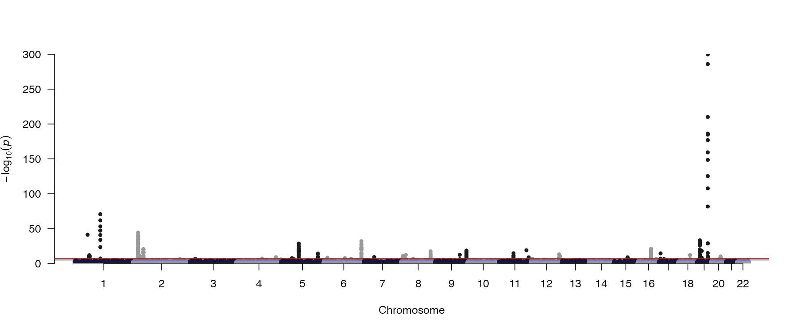

# brownstone

**Brownstone plots**: a successor to the GWAS Manhattan plot. Alongside the usual −log₁₀(*P*) skyline it shows **how big each effect is (and how precise)**, **whether a signal comes from a common or a rare variant**, and **which gene each locus sits in**, in a clean modern style built on ggplot2.



*`brownstone(simulate_gwas(), suggestive = 1e-5)`*

**Why "brownstone"?** The name is a play on the Manhattan plot, which is named for the city skyline its towers of *P*-values resemble. Across the East River from Manhattan's skyscrapers stand Brooklyn's low-rise brownstones, just as the effect-size track here sits low beneath the *P*-value skyline.

## What it adds to a classic Manhattan plot

| Classic Manhattan | brownstone |
|---|---|
| Shows *P* only; a huge-*N* common variant with a tiny effect looks the same as a rare variant with a huge one. | An **effect track** beneath the chromosome axis shows the size of each lead variant's effect, \|β\| (or the OR of the risk allele) ± 95% CI. Each tower of *P*-values stands directly above its own effect estimate. |
| No sign of allele frequency, so rare- and common-variant signals are indistinguishable. | Significant variants are **coloured by minor allele frequency** (blue ≥ 5%, aqua 1–5%, orange 0.1–1%, berry < 0.1%, or a continuous scale), in both panels, with colour-blind-safe palettes. The pattern of rare variants with large effects is visible at a glance. |
| Gene names added by hand afterwards. | Loci are clumped and **labelled with the nearest gene** automatically (Ensembl, GRCh37 or GRCh38), or with any labels you supply. |
| One giant locus (APOE, HLA, ...) flattens everything else. | The axes **react to the data**. If anything passes −log₁₀ *P* = 20, the y axis breaks there and puts the long tail on a compressed log scale, so most of the height goes to the region around the significance lines. The effect axis does the same when one effect (typically a rare variant's) dwarfs the rest. |
| Suggestive peaks are a line at best. | An optional **suggestive tier**: peaks between 10⁻⁵ and 5 × 10⁻⁸ are drawn as hollow rings and labelled in grey. |
| Dated base-graphics look. | Minimal chrome: alternating chromosome bands, grey noise floor, colour reserved for hits. |

## Installation

```r
# from a local clone
devtools::install("path/to/brownstone")
```

Depends on ggplot2 (≥ 3.5), ggrepel, patchwork and scales.

## Quick start

```r
library(brownstone)

gwas <- simulate_gwas()          # or your own summary statistics
brownstone(gwas)              # GRCh38 positions by default
brownstone(my_sumstats, build = "GRCh37")
```

Columns are detected automatically from the usual names used by PLINK, REGENIE, BOLT-LMM, SAIGE, METAL and the GWAS-SSF standard (`CHR`/`#CHROM`/`chromosome`, `BP`/`POS`/`GENPOS`/`base_pair_location`, `P`/`p_value`/`LOG10P`, `BETA`/`OR`, `SE`, `EAF`/`A1FREQ`/`MAF`, `SNP`/`rsid`/`ID`, ...). Anything else can be named explicitly:

```r
brownstone(ldl, chr = "CHR", pos = "BP", p = "P-value", eaf = "Freq.A1.1000G.EUR",
              build = "GRCh37")
```

Only chromosome, position and *P* are required. Without effect and SE columns the plot is drawn without the effect track. Without frequencies, hits are drawn in a single colour.

For large files, read only the columns the plots use: chromosome, position, *P* (or −log₁₀ *P*), β, SE, an allele frequency, a variant ID, and any column you label loci with. For FinnGen's REGENIE output:

```r
fg <- data.table::fread("finngen_R12_E4_HYPERCHOL.gz", data.table = FALSE,
                        select = c("#chrom", "pos", "rsids", "nearest_genes",
                                   "mlogp", "beta", "sebeta", "af_alt"))
```

For that file this shrank the table in memory from 3.15 to 2.34 GB, and the read from about 16 to 14 s.

## Reading the plot

- **Grey floor**: every variant below the significance line, thinned to one point per cell of a fine grid (invisible at normal sizes), so that millions of variants plot in a few seconds.
- **Coloured points**: variants with *P* < 5 × 10⁻⁸, coloured by minor allele frequency class, rarest drawn on top. Significant variants with no frequency are drawn as "Unknown", in a light grey underneath the rest. With `maf_scale = "continuous"`, colour follows log₁₀(MAF) on a viridis ramp instead (dark purple = rare). There are no cut-offs, and every variant above 10% shares one green so the towers stay calm. Colour always follows the *minor* allele frequency, which, unlike the effect allele frequency, doesn't depend on which allele the GWAS reported.
- **Hollow rings** (with `suggestive = 1e-5`): peaks that reach the suggestive line but not genome-wide significance, in their frequency colour. They are labelled in grey after the genome-wide significant loci, and shown on the effect track as hollow points (`label_suggestive`, `track_suggestive`). Variants between the two lines that belong to a significant locus stay grey, because they are the base of its tower, not a peak of their own.
- **Labels**: one per locus (most significant first, up to `max_labels`), italic for gene symbols.
- **Broken axis**: a white strip edged with hairlines, at 2.5 × the significance line (−log₁₀ *P* = 20 for 5 × 10⁻⁸), drawn only when something goes above it. Below it the axis is linear; above it −log₁₀ *P* is on a log scale with about 15% of the height per decade, so a locus at 600 still sits above one at 100, but neither steals space from the threshold region. Set the break with `y_compress = 30`, or turn it off with `FALSE`.
- **Effect track**: the size of every hit's effect, \|β\|, i.e. the effect per copy of the trait-increasing allele (for odds ratios, the OR of the risk allele). Lead variants are large points with their 95% CI; every other hit is a small point. Most of these are LD proxies, sitting just under their lead, because LD only ever shrinks a proxy's expected effect, so a point clearly above its lead suggests a second signal. `track_variants = "leads"` shows the leads alone. The sign is left out by default because for a single variant it only says which allele the GWAS happened to report. It starts to matter when you compare, e.g. across traits or for MR. `effects = "signed"` keeps it, oriented to the minor allele, for lead variants only, since proxies are reported against arbitrary alleles. The axis is linear, so effects are drawn in proportion, unless a few estimates dwarf the rest (twice the break, which is 3 × the median lead effect rounded up, so at least 6 × the median). Then it breaks like the P-value axis and puts the outliers on a log scale at the top of the track. Wide confidence intervals alone never trigger it. `effect_scale = "sqrt"` gives a smooth square-root scale instead.
- **Allelic series**: the track also shows the strongest variant of each other frequency class within a locus, but only when it is too significant to be an LD shadow of the locus lead (see below). A common and a rare signal at the same gene then appear as two dots, one above the other.

## Real data

GLGC 2013 LDL cholesterol (2.4 M HapMap-imputed variants, hg19; [Willer et al. 2013](https://doi.org/10.1038/ng.2797)). *PCSK9* rs11591147 (R46L, MAF 1.7%) stands out with no special handling: it's a low-frequency variant with one of the two largest effects on the track. *APOE* rs7412's *P*-value (1.24 × 10⁻⁶⁵²) is too small for a double. It is read exactly from the text, and *P*-values that are already 0 fall back to β/SE.



```r
ldl <- data.table::fread("jointGwasMc_LDL.txt.gz", data.table = FALSE)
chr_pos <- do.call(rbind, strsplit(ldl$SNP_hg19, ":", fixed = TRUE))   # "chr10:9960129"
ldl$CHR <- chr_pos[, 1]
ldl$BP <- as.numeric(chr_pos[, 2])
brownstone(ldl, eaf = "Freq.A1.1000G.EUR", build = "GRCh37")
```

## Colour-blind safety

Every default colour set is checked for distinguishability under simulated protanopia, deuteranopia and tritanopia (Machado et al. 2009; distances in OKLab ×100, ≥ 8 is the target):

- **Binned:** blue / aqua / orange / berry, plus the light "Unknown" grey. The worst pair is ΔE 9.2 under deuteranopia (aqua vs orange) and 9.6 under tritanopia. Berry, the ultra-rare class, is at least ΔE 19 from every other colour. An earlier mid-grey for Unknown failed (ΔE 5.1 against aqua under deuteranopia) and was replaced.
- **Continuous:** the ramps (viridis, mako, one-hue blue) change lightness monotonically, so they can be read by lightness alone.
- **Ordinal set:** `maf_colours(palette = "ordinal")` is a single hue.

Aqua is slightly under 3:1 contrast against white. The legend and direct labels carry its meaning, and the suggestive rings are drawn thicker for that reason.

## Tested on

- **FinnGen release 12**, pure hypercholesterolaemia (E4_HYPERCHOL). This is REGENIE output for a binary trait (log odds ratios): 21.3 million variants, including 838k on chromosome X. On a 10-core Apple M4 laptop with 32 GB of memory, reading the file with `data.table::fread()` took about 16 s. `brownstone()` then built the plot in 3.8 s, and saving it as a 12 × 6.5 in PNG took 1.1 s (4 s as a PDF). `qq_plot()` took 4 s, plus 0.1 s to save. The whole run peaked at 7.2 GB of memory, including the 3.1 GB input table.
- **GLGC 2013 LDL cholesterol**, 2.4 million variants on hg19.
- **The example binary-trait outputs that ship with REGENIE and SAIGE**, including SAIGE on chromosome X. The −log₁₀ *P* values computed by the package match those in the files exactly.

`vignette("brownstone")` walks through the options. A draft JOSS paper is in [article/paper.md](article/paper.md).

## Annotating loci

```r
brownstone(gwas)                      # nearest protein-coding gene (default)
brownstone(gwas, labels = "snp")      # variant IDs
brownstone(gwas, labels = "GENE")     # a column of your own (e.g. from FUMA or VEP)
brownstone(gwas, labels = NULL)       # no labels
```

For anything else, pass a table with a `label` column and either `snp` or `chr` + `pos`. An optional `fontface` column styles individual labels. `find_loci()` returns a ready-made table of lead variants to start from:

```r
loci <- find_loci(gwas)                  # lead variants, nearest gene, locus span
loci$label <- loci$gene
loci$fontface <- ifelse(loci$gene %in% known_genes, "italic", "bold.italic")
brownstone(gwas, labels = loci) + patchwork::plot_annotation(subtitle = "Novel loci in bold")
```



## Other options

| Argument | Default | |
|---|---|---|
| `threshold`, `suggestive` | `5e-8`, `NULL` | Significance lines (labelled on the right-hand axis). `suggestive = 1e-5` adds the suggestive tier. |
| `label_suggestive` | `TRUE` | Label suggestive loci too (after the genome-wide significant ones). |
| `effects` | `"magnitude"` | `"signed"` keeps the direction; `"none"` drops the track. |
| `window` | `5e5` | Half-width for distance clumping into loci. |
| `max_labels` | `40` | Label only the most significant loci. |
| `effect_scale` | `"auto"` | Linear, breaking for outlying effects; or `"sqrt"`, or `"linear"` (never break). |
| `maf_scale` | `"binned"` | `"continuous"`: colour by log₁₀(MAF) on a ramp (`maf_ramp()`: viridis, mako or blue). |
| `allelic_series` | `TRUE` | `FALSE` shows one variant per locus on the track. |
| `maf_breaks` | `c(0.001, 0.01, 0.05)` | Frequency class boundaries: ultra-rare, rare, low-frequency, common. |
| `colours` | `maf_colours()` | Class colours, or a ramp for the continuous scale. `maf_colours(palette = "ordinal")` gives a one-hue light-to-dark set. |
| `y_compress` | `"auto"` | Break at 20 (for 5 × 10⁻⁸) if anything passes it; a number sets the break; `FALSE` turns it off. |
| `effect_allele` | `"minor"` | For signed effects: `"as_is"` keeps effects oriented as in the input. |
| `track_variants` | `"all"` | \|β\| of every hit (and every suggestive variant, with `suggestive` set); `"leads"` for the lead variants only. Signed effects always show leads only. |
| `track_suggestive` | `TRUE` | Put suggestive loci on the effect track (with `suggestive` set). |
| `track_direction` | `"up"` | `"down"` hangs the effect track from the Manhattan axis, like a reflection of the skyline. |
| `track_height`, `label_angle`, `base_size`, `point_size` | | Layout. `label_angle = 90` packs more labels when there are many loci. |

The result is a patchwork object: add a title with `+ patchwork::plot_annotation(title = ...)`, and save with `ggsave()`. At journal width (183 mm), use `base_size = 7, point_size = 0.8`.

## QQ plot and genomic inflation

`qq_plot()` draws the companion QQ plot. There is one curve per minor allele frequency class, each compared with its own expected distribution, and the genomic inflation factor λ<sub>GC</sub> is printed on the plot, for all variants and for each class:

```r
qq_plot(gwas)
```



Rare-variant tests are often calibrated differently from common-variant ones, and a single curve hides that. In FinnGen's hypercholesterolaemia GWAS, for example, λ is 1.25 for common variants but 1.05 for variants rarer than 0.1%. The grey bands are pointwise 95% intervals, one per class. λ assumes 1-df tests, and under polygenicity it grows with sample size even without confounding (the LD score regression intercept tells the two apart). `qq_plot()` warns when the *P*-values look filtered (fewer than a quarter above 0.5), because a QQ plot needs every tested variant.

## Before and after

The same simulated GWAS through `qqman::manhattan()`:



## Caveats

- **Nearest gene is not causal gene.** Labels are the nearest protein-coding gene to the lead variant, which is often but not always the gene responsible. The classic example is the *APOE* locus, whose lead variants are frequently annotated to the neighbouring *TOMM40*.
- **Loci are found by distance** (±500 kb around the most significant variant, repeated), not by LD clumping or conditional analysis. Two independent signals closer than `window` count as one locus.
- **The allelic-series check uses allele frequencies only.** Two variants with minor allele frequencies *f*₁ ≤ *f*₂ can be correlated at most *r* = √(*f*₁(1 − *f*₂) / (*f*₂(1 − *f*₁))). A variant from another frequency class is added to the track when its \|z\| exceeds that ceiling × \|z\| of the locus lead + 2: LD with the lead could not produce it, so it is at least partly its own signal. This needs no LD reference, but it is a screen, not a conditional analysis.
- **Signed effects are oriented to the minor allele** when an effect-allele frequency column is present (β is negated where EAF > 0.5), so that the sign means the same thing at every locus. For rare variants that is usually the derived, functional allele; for common variants it is close to arbitrary, which is why the default track shows magnitudes.
- **Effects are not corrected for winner's curse.** Lead-variant effects are biased upwards, especially for rare variants and for loci just past the threshold. Suggestive loci are the most affected: a rare variant that only reaches 10⁻⁵ sits high on the track simply because its standard error is large. `track_suggestive = FALSE` keeps them off it.

## Functions

- `brownstone()`: the plot.
- `qq_plot()`: QQ plot by allele frequency class, with genomic inflation.
- `find_loci()`: lead variants by distance clumping, with nearest genes.
- `nearest_gene()`: nearest protein-coding gene to any positions.
- `standardise_sumstats()`: column detection and cleaning.
- `simulate_gwas()`: realistic simulated summary statistics (common and rare causal variants with LD).
- `theme_brownstone()`, `maf_colours()`: styling.
- `genes_grch37`, `genes_grch38`: protein-coding gene coordinates from Ensembl (GRCh37 release 87, release 116).

The design iterations behind these choices, including the alternatives that were rejected, are in [design/DESIGN.md](design/DESIGN.md).
